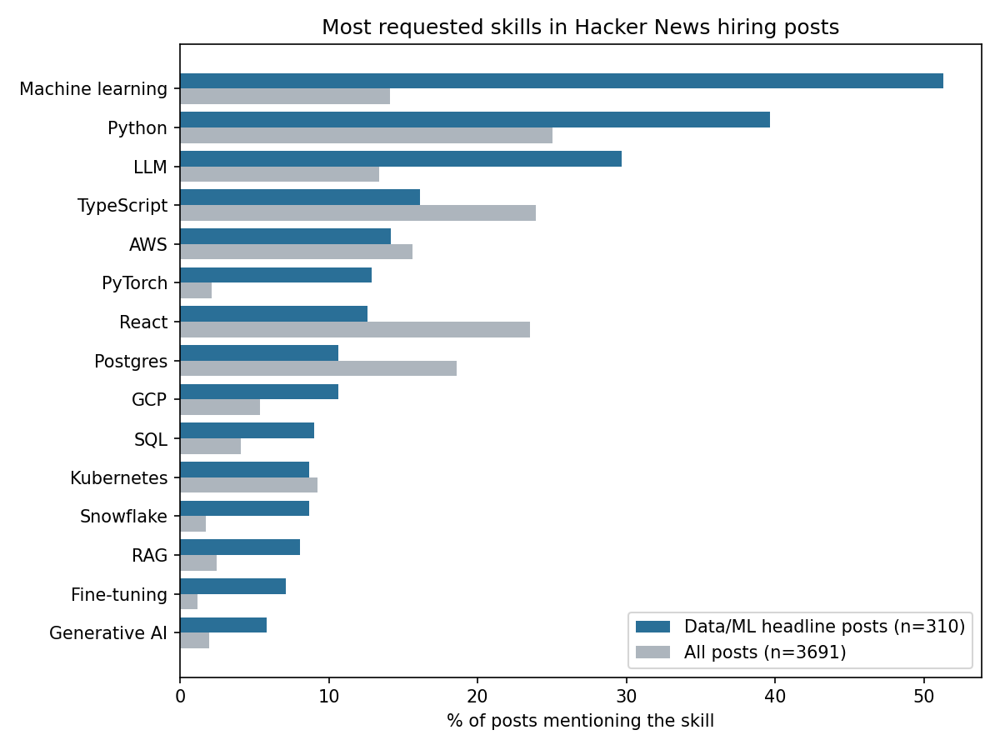
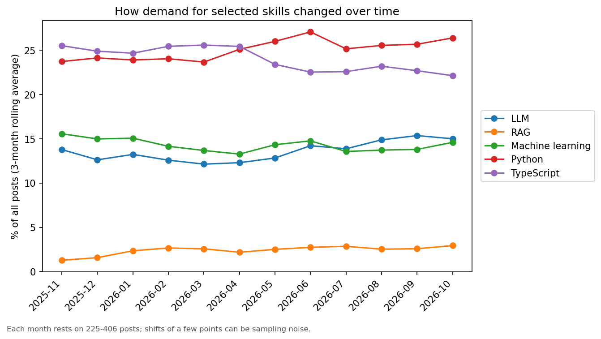

# What Do Hacker News Job Posts Ask For?

An exploratory NLP analysis of 3,691 job posts from Hacker News's monthly "Ask HN: Who is hiring?" threads, focused on which skills appear in data and machine learning roles and how demand changed over 12 months.

## Question

Which skills are named most often in data/ML job posts, and how do they differ from the rest of the posts? Did demand for skills like LLMs and RAG change over the last year?

## Data

- **3,691 posts** from 12 monthly threads, **November 2025 to October 2026** (225 to 406 posts per month).
- Collected through the public Hacker News Algolia API with `src/collect_hn_hiring.py`. Only top-level posts are kept. Author names are never stored and email addresses are redacted.
- Median post length is about 1,000 characters (90th percentile 1,730).
- The full raw data is not in this repo. A 50-post sample is in `data/sample/`.

## Method

1. **Collection:** a script downloads each thread and cleans the HTML to plain text.
2. **Skill extraction:** a dictionary of about 40 skills and tools (`src/skills.py`), each matched with a regular expression. Ambiguous names are handled on purpose: "R" and "Go" are excluded because they match ordinary words, and names like Rust, React and Spark are matched case-sensitively.
3. **Data/ML posts:** a rule on the post's headline (`src/explore_skills.py`) flags posts that name a data/ML role, such as Data Scientist, Data Engineer, ML Engineer or AI Engineer.
4. **Analysis:** the share of posts mentioning each skill, overall and in flagged posts, plus monthly trends with a 3-month rolling average.

## Findings

**310 posts (8.4%)** have a headline naming a data/ML role. This is a strict rule, so it is a lower bound.

| Skill | Flagged data/ML posts | All posts |
|---|---|---|
| Machine learning | 51% | 14% |
| Python | 40% | 25% |
| LLM | 30% | 13% |
| PyTorch | 13% | 2% |
| SQL | 9% | 4% |
| Snowflake | 9% | 2% |
| RAG | 8% | 2.5% |
| Fine-tuning | 7% | 1% |
| React | 13% | 24% |
| TypeScript | 16% | 24% |

- **Data/ML posts stand out on ML tooling** (PyTorch, LLM, RAG, fine-tuning) and are less web-focused (React and TypeScript appear about half as often).
- **SQL is rare in this slice of the market.** Only 4.1% of all posts name it (151 posts). About 12.5% mention "sql" somewhere, mostly as Postgres, MySQL or NoSQL. I checked this with an independent count to rule out a matching bug. Hacker News posts lean toward engineering, so this does not describe analyst jobs in general.
- **Work mode:** 55% of posts mention remote, 31% onsite and 20% hybrid (a post can mention several), and 38% mention a salary figure.

### Trends

Demand looks **mostly stable**. LLM mentions stay at about 12% to 15% of all posts, with no surge. RAG rises from about 1% to about 3%, but from a very small base. Python edges up and React drifts down by a few points. With 225 to 406 posts a month, shifts of a few points are within sampling noise, so these are suggestive rather than proven.

## Checks I made

- **SQL count cross-check:** an independent text count matched the skill extractor exactly.
- **Headline rule fixed:** my first rule matched the word "AI" anywhere, so it flagged company names and web addresses (for example "krea.ai | Backend Engineer"). Reading 25 flagged headlines by eye, the first rule included about 13 non-data roles. The revised rule requires a role title and removed all of them. This was a manual check on a small sample, not a measured accuracy.
- **Skill spot-check:** I read 15 random posts against the extracted skills and found no obvious wrong matches.

## Limitations

- **Hacker News is not the whole job market.** Posts skew toward startups and software engineering, so results do not describe data analyst or data scientist jobs in general.
- **The data/ML flag is based on headlines only.** Posts that name their roles only in the body are missed, so its recall is unmeasured.
- **No formal evaluation yet.** I built a hand-labelling tool and an evaluation script for a gold set (`src/make_labeling_tool.py`, `src/evaluate_gold.py`), but I have not completed the labelling, so the classifier accuracy is not reported. The evaluation script has only been tested on synthetic data.
- **Keyword matching** misses synonyms and spelling variants, and can match names that are also ordinary words.
- **Monthly shares are noisy,** especially for the data/ML subset (15 to 36 flagged posts a month).

## Next steps

Complete the gold-set labelling, report the headline rule's precision and recall, and compare it with a TF-IDF classifier that sees only the post body.

## Repository contents

| Path | Purpose |
|---|---|
| `src/collect_hn_hiring.py` | Downloads and cleans the hiring threads |
| `src/skills.py` | Skill dictionary and matcher |
| `src/explore_skills.py` | Statistics, skill shares, trends and charts |
| `src/diagnostics.py` | Checks on the headline rule and SQL counts |
| `src/make_labeling_tool.py`, `src/evaluate_gold.py` | Gold-set labelling and evaluation (in progress) |
| `results/` | Aggregated tables and charts |

To reproduce: `pip install -r requirements.txt matplotlib`, then run `python src/collect_hn_hiring.py` followed by `python src/explore_skills.py`.

## Tech stack

Python, pandas, matplotlib, regular expressions, scikit-learn (evaluation script)

## Author

David Kamiti | [GitHub](https://github.com/Davidkamiti)
